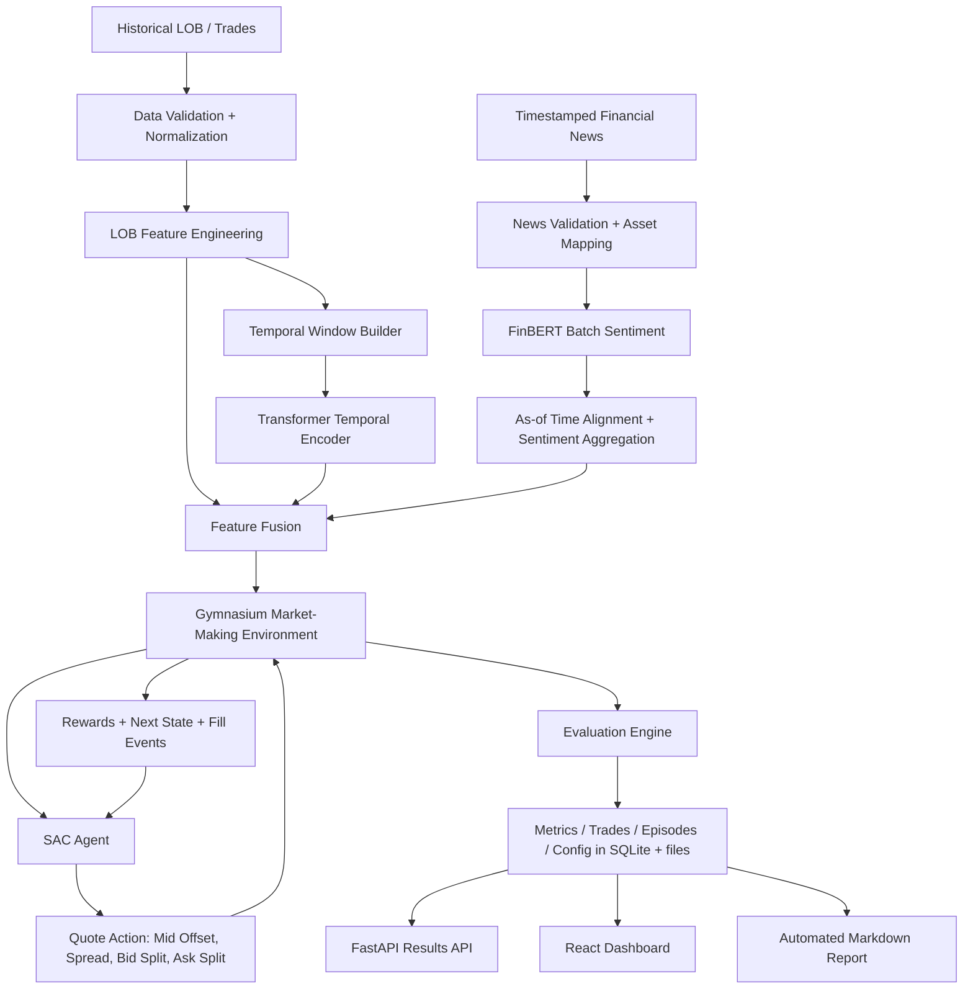

# LLM-Enhanced Financial Market Making

Research / backtesting project: a multi-price-level market-making agent trained with Soft Actor-Critic (SAC), extended with
FinBERT sentiment features and a frozen Transformer temporal encoder, evaluated by historical replay against two baselines and
four ablations, with a read-only API, a React dashboard and an auto-generated final report.

> **Research and backtesting only.** No live trading, no broker or exchange credentials, no real-money execution. Nothing here is
> investment advice. Fills are approximated from historical snapshots; backtest PnL is not live PnL.

**Correction to the original slides.** The base paper (IMM, IJCAI 2024) is *already a multi-price-level* method (multi-price-level
order stacking, two bid and two ask levels in its experiments). This project inherits that structure and does **not** claim
multi-price-level quoting as new. IMM uses LightGBM for multi-horizon predictive signals plus a TCSA representation network, and TD3 with
an imitation / behavior-cloning loss; this project uses a Transformer encoder and SAC, and implements no imitation loss. FinBERT is a
pretrained financial *sentiment classifier*, not a generative LLM trading agent. See "Known limitations" and the generated report
(section 5) for the full list of corrections.

## Architecture



FinBERT never runs inside the RL loop. Sentiment is scored once, cached, aligned without look-ahead (`published_at <= t`), and the
environment consumes numeric arrays only.

Pipeline stages and the scripts behind them:

| Stage | Script | Output |
|---|---|---|
| validate + split | `scripts/prepare_data.py` | (checks only) |
| base features (+ FinBERT) | `scripts/build_features.py --stage base` | `artifacts/features/` |
| Transformer | `scripts/train_transformer.py` | `artifacts/transformer/checkpoint.pt` |
| fusion | `scripts/build_features.py --stage fusion` | `artifacts/features/<variant>_<split>.npy` |
| experiments (variants x seeds + baselines) | `scripts/run_experiments.py` | `artifacts/rl/`, `artifacts/evaluation/`, SQLite |
| report | `scripts/generate_report.py` | `artifacts/reports/FINAL_PROJECT_REPORT.md` |
| all of the above | `scripts/run_all.py` | + `artifacts/logs/pipeline_status.json` |

Model variants: `HEURISTIC`, `AVELLANEDA_STOIKOV` (baselines, no learning) and `SAC_LOB_ONLY`, `SAC_LOB_TRANSFORMER`, `SAC_LOB_SENTIMENT`,
`SAC_FULL` (learned; same split, windows, fees, reward and budget).

## Data modes

| Mode | Data | Use |
|---|---|---|
| **A** | real LOB + matched real news | full pipeline (not available in this project) |
| **B** | real crypto LOB (self-collected Binance order book, or public Binance data) + real equity news (FNSPID) | the real-data mode of this project. The news and the order book are **not causally matched** (different asset and period); sentiment is validated separately and no claim is made that news improved trading on the crypto book |
| **C** | deterministic synthetic data (`make sample-data`) | software smoke test only. Every artifact is labeled **SOFTWARE SMOKE TEST ONLY - NOT A FINANCIAL PERFORMANCE RESULT** |

If no news file exists, the pipeline runs news-optional: sentiment variants are skipped and recorded as N/A with the reason.

## Setup

Requirements: Python 3.11, Node 20+, git. Step-by-step instructions for beginners are in [`docs/RUNBOOK.md`](docs/RUNBOOK.md).

```bash
make install            # creates .venv and installs requirements + the package
source .venv/bin/activate
make install-frontend   # npm install in frontend/
pytest -q               # Python tests (all should pass)
```

## Quickstart: 10-minute demo (synthetic data)

```bash
source .venv/bin/activate
make demo-data          # synthetic data + stub sentiment + fast experiment (about 1 minute); writes artifacts/ and the SQLite DB
make demo               # starts the API (port API_PORT, default 8000) and the dashboard (port 5173); Ctrl-C stops both
```

Open the printed dashboard URL. Port 8000 busy (for example by Docker)? Use `API_PORT=8765 make demo`; the dashboard is started with the
matching `VITE_API_URL` automatically. If you start the frontend yourself, put `VITE_API_URL=http://localhost:8765` into `frontend/.env.local`.
Everything shown in this mode is a pipeline check, not a performance result.

## Real-data workflow

```bash
source .venv/bin/activate
# 1. collect a live Binance order book (free, no key). Keep the laptop awake; hours to days are recommended
python scripts/collect_binance_lob.py --symbol BTCUSDT --depth 5 --interval-ms 500 --duration-minutes 240 \
    --out-dir data/raw/lob/btcusdt_run1
python scripts/merge_lob_parts.py --parts-dir data/raw/lob/btcusdt_run1 --out data/processed/lob_binance.parquet
# 2. news (FNSPID, streamed from Hugging Face)
python scripts/prepare_fnspid.py --tickers AAPL --max-rows 5000
# 3. configure: copy and edit configs/real_binance.yaml (tick size, volumes, seeds, timesteps)
# 4. features -> Transformer -> check the plan -> real run
python scripts/run_all.py --config configs/real_binance.yaml --dry-run
python scripts/run_all.py --config configs/real_binance.yaml --resume       # long; resumable
```

Public Binance daily files are an alternative source but have depth 1 only (`scripts/download_binance_public.py`, set `data.depth: 1`).
Arbitrary CSV/Parquet order-book files can be mapped with `market_maker.data.adapters.load_lob_with_mapping`.

## Training workflow (step by step)

```bash
python scripts/prepare_data.py   --config configs/real_binance.yaml
python scripts/build_features.py --config configs/real_binance.yaml --stage base        # real FinBERT; add --stub-sentiment for smoke tests only
python scripts/train_transformer.py --config configs/real_binance.yaml
python scripts/build_features.py --config configs/real_binance.yaml --stage fusion
python scripts/run_experiments.py --config configs/real_binance.yaml --dry-run          # plan + estimated work
python scripts/run_experiments.py --config configs/real_binance.yaml --experiment-id real_v1 --resume
python scripts/generate_report.py --experiment-id real_v1
```

`make` shortcuts: `make features`, `make train-transformer`, `make experiments`, `make experiments-fast`, `make report`,
`make full-run` (all stages with `configs/real_binance.yaml`, add `DRY=--dry-run` to preview), `CONFIG=...` selects the config.
Checkpoint selection uses the validation split only; the test split is touched once, after training.

## UI screens

Overview, **Episode Replay** (quotes, fills, inventory and PnL step by step, compare against another run), PnL / Equity, Inventory & Risk,
Market-Making Behavior (cancel ratio, fill rate, spreads, adverse selection, PnL attribution), **Training** (learning curves, best
checkpoint), Sentiment & Signals, **Model Comparison** (mean ± std over seeds, exploratory pairwise tests). Synthetic runs carry a visible
smoke-test label.

## API endpoints (read-only, no auth)

`GET /health`, `/runs`, `/runs/summary`, `/runs/{id}`, `/runs/{id}/metrics`, `/runs/{id}/episodes`, `/runs/{id}/fills`, `/runs/{id}/equity-curve`,
`/runs/{id}/pnl-attribution`, `/runs/{id}/episodes/{ep}/replay`, `/runs/{id}/training-curve`, `/experiments`, `/experiments/{id}`, `/signals`.
Interactive docs at `http://localhost:<API_PORT>/docs`. Env vars: `MARKET_MAKER_DB_PATH`, `MARKET_MAKER_ARTIFACTS_ROOT`.

## Artifacts layout

```text
artifacts/
  market_maker.db                 SQLite (runs, metrics, episodes, fills, steps, experiment_aggregates)   [git-ignored]
  features/                       lob_<split>.parquet, <variant>_<split>.npy, scaler.joblib, feature_meta.json
  sentiment/                      cached FinBERT scores (news_sentiment.parquet; *_stub.parquet is the smoke-test stub)
  transformer/                    checkpoint.pt, training_curve.csv
  rl/<variant>/seed<N>/           best_model.zip (validation-selected), last_model.zip, training_curve.csv
  evaluation/<run_id>/            config.yaml, metadata.json, metrics.json, episodes/fills/orders/quotes.csv, training_curve.csv, plots/, report.md
  evaluation/<experiment>_summary.json|csv   mean +- std per variant, Welch tests (exploratory)
  logs/pipeline_status.json       written by run_all.py (timings, skipped variants)
  reports/FINAL_PROJECT_REPORT.md (+ figures/)
```

Run ids are `<variant>_seed<N>` and `heuristic`, `avellaneda_stoikov`; folders are shared by experiments ("latest wins").

## Tests

```bash
pytest -q                 # Python
make test                 # Python + frontend (vitest)
make lint
```

## Known limitations

- Fills and queue priority are approximated from historical snapshots/aggregated trades and are not equivalent to a full message-level exchange reconstruction; historical replay cannot model the agent's own market impact.
- Mode B: news and order book are not matched in time or asset; no causal sentiment-to-PnL claim.
- The Transformer is frozen during SAC training; no IMM imitation loss, stable reference price or TCSA; TD3 was not run.
- Results depend on few seeds; the reported tests are exploratory. The shipped real config has placeholder budgets and unit sizes that you must set for your instrument.
- Episodes are not checked against gaps in collected data.
- The dashboard is React (the spec's Streamlit dashboard was replaced).
- Details: `docs/SPEC_COMPLIANCE.md`, the generated report (section 21), and `docs/RUNBOOK.md`.

## Docs

[`docs/RUNBOOK.md`](docs/RUNBOOK.md) (beginner guide), [`docs/SPEC_COMPLIANCE.md`](docs/SPEC_COMPLIANCE.md), [`BUILD_STATUS.md`](BUILD_STATUS.md), `docs/superpowers/reports/` (per-work-package notes).

## Disclaimer

Academic / research use only. Not financial advice. No live trading functionality exists in this repository.
